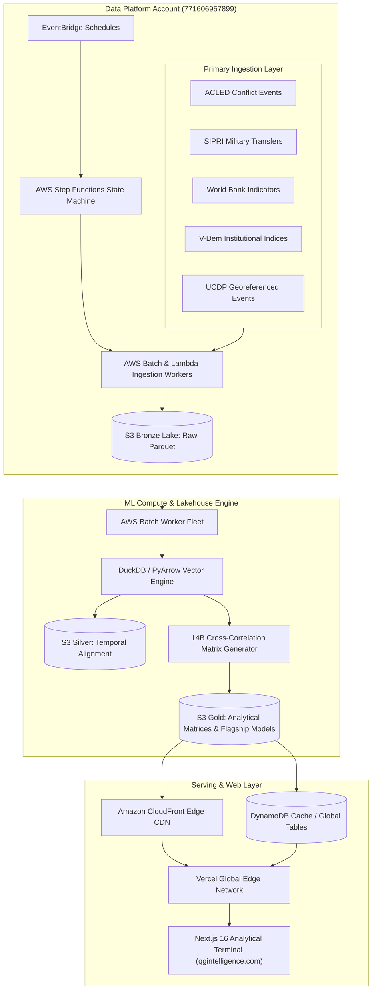

# Quantitative Geopolitical Intelligence (QGI)

[](https://github.com/AminAlAit/qgi/actions/workflows/ci.yml)
[](https://qgintelligence.com)
[](infra)
[](ml)
[](frontend)
[](LICENSE)

QGI is an enterprise-grade cloud data platform and quantitative risk modeling engine. It continuously ingests, aligns, and models high-dimensional geopolitical, trade, and macroeconomic time-series, computing over **14 billion pairwise cross-correlations** to map systemic global vulnerability propagation in real time.

Live Interactive Platform: **[https://qgintelligence.com](https://qgintelligence.com)**

> **Historical Lineage:** Looking for the original 2024 rapid-research prototype built in Python and Streamlit? View the preserved showcase at **[AminAlAit/qgi-streamlit](https://github.com/AminAlAit/qgi-streamlit)**.

---

## System Architecture



---

## Repository Structure

```text
qgi/
├── frontend/          # Next.js 16 App Router, React 19, TypeScript, Tailwind v4, Vitest (492 tests)
├── pipeline/          # Serverless Medallion ETL (ACLED, SIPRI, World Bank, UCDP, GDELT) + Moto test suite
├── ml/                # Endogenous Geopolitical Trajectory Engine, 12 Flagship Models & Backtest Harness
├── infra/             # Multi-Account AWS Terraform IaC (Management, Staging, QA, Prod) + GitHub OIDC
├── data-tools/        # DuckDB & PyArrow schema verifiers, control surface registries, and validation suites
├── docs/              # Quantitative methodology papers, architecture specs, and SIPRI/ACLED attribution
└── scripts/           # Full-stack 6-gate offline verification harness (verify-monorepo.ps1 / .sh)
```

---

## The 12 Flagship Quantitative Models

All active models are engineered strictly with **endogenous socio-political, institutional, military, and macroeconomic boundaries** (Decisions D30 & D33), preventing lookahead contamination and excluding unmodelable exogenous shocks (`natural_disaster` and `epidemic_and_pandemic` are permanently deactivated):

| Model Code | Flagship Model Identifier | Mathematical / Econometric Framework | Target Phenomenon |
| :--- | :--- | :--- | :--- |
| **SCVI** | Sovereign Conflict Velocity Index | Vector Autoregression (VAR) with Lagged Hazard Regimes | Escalation velocity across fragile borders |
| **SCDP** | Structural Coup & Destabilization Probability | Institutional Survival Hazard & V-Dem Decay Modeling | Regime destabilization and irregular executive transitions |
| **SDCP** | Sovereign Debt & Currency Pressure | Dynamic Factor State-Space Models with Reserve Spreads | Cross-border sovereign debt and currency stress |
| **CMSS** | Chokepoint & Maritime Supply Stress | Graph-Theoretic Maritime Transit & Trade Flow Decomposition | Bottlenecks across strategic trade corridors |
| **DEAI** | Diplomatic Escalation & Alignment Index | Dynamic Network Modularity & Bilateral Alignment Shifts | Realignment of diplomatic and defense commitments |
| **ETGR** | Energy Transition & Grid Resilience | State-Space Hydrocarbon & Grid Sensitivity Index | Fiscal and infrastructure stress under energy shifts |
| **SSTM** | Sanctions Spillover & Trade Contagion | Inter-Country Input-Output (ICIO) Contagion Inversion | Secondary economic dislocation from trade sanctions |
| **CTDI** | Cyber & Telecom Disruption Index | Impulse-Response Shock Decay & Infrastructure Coupling | Critical telecom and sovereign digital disruptions |
| **CWKC** | Civil War & Kinetic Conflict | Markov-Switching Autoregressive Escalation (MS-AR) | Armed intra-state conflict onset and persistence |
| **DIRSM** | Democratic Backsliding & Institutional Decay | Hierarchical Bayesian Latent Institutional Fragility | Judicial, electoral, and civil-liberties erosion |
| **FSSI** | Food & Strategic Commodity Stress | State-Space Import Elasticity & Reserve Adequacy | Sovereign vulnerability to grain and commodity shocks |
| **MACM** | Military Expenditure & Arms Trajectory | Hodrick-Prescott Structural Defense Burden Acceleration | Regional arms procurement inflection points |

---

## Enterprise Cloud Infrastructure (Decoupled AWS Multi-Account Topology)

The infrastructure is provisioned through modular Terraform across isolated AWS accounts governed by AWS Organizations Service Control Policies (SCPs) and zero-trust GitHub Actions OIDC federation:

| Account Role | AWS Account ID | Operational Scope |
| :--- | :--- | :--- |
| **Management / Org Root** | `783811616921` | AWS Organizations, SCP guardrails, IAM Identity Center, centralized CloudTrail |
| **Staging** | `771606957899` | Active Medallion S3 Lakehouse (`qgi-data-lake-*`), Step Functions, Batch, Athena |
| **QA** | `928648269104` | Deterministic pre-promotion integration verification and schema contract testing |
| **Production** | `297797204453` | Declarative production target for high-availability serving and lakehouse storage |

---

## Local Development & Verification Quickstart

### Prerequisites
- Python 3.11+ (`ruff`, `mypy`, `pytest`)
- Node.js 20.x & npm
- Terraform CLI $\ge 1.6.0$

### Setup & Local 6-Gate Verification

```powershell
# 1. Clone repository
git clone https://github.com/AminAlAit/qgi.git
cd qgi

# 2. Install Python dependencies for Pipeline, ML, and Data-Tools
pip install -r pipeline/requirements.txt
pip install -r ml/requirements.txt
pip install -r data-tools/requirements.txt

# 3. Install Frontend dependencies
cd frontend
npm ci
cd ..

# 4. Run the full 6-gate offline verification suite
pwsh -ExecutionPolicy Bypass -File ./scripts/verify-monorepo.ps1
```

---

## Historical Evolution: 2024 Prototype to 2026 Distributed Monorepo

QGI began in January 2024 as an exploratory Streamlit prototype ([AminAlAit/qgi-streamlit](https://github.com/AminAlAit/qgi-streamlit)). As indicator density expanded across 214 sovereign entities and six decades of historical records, memory constraints and execution latencies mandated an enterprise re-architecture. The modern monorepo reflects the lessons learned from that prototype: separating compute from state, enforcing multi-tenant cloud blast-radius isolation, and optimizing vectorized columnar pipelines for sub-second terminal queries.

| Architectural Dimension | 2024 Prototype (`qgi-streamlit`) | 2026 Production Monorepo (`qgi`) |
| :--- | :--- | :--- |
| **Cloud Topology** | Single-VM monolithic process | 5-Account isolated AWS cloud estate (Terraform) |
| **Correlation Scale** | $O(10^5)$ pairwise checks, Pandas in-memory | **14+ Billion** pairwise rolling correlations, DuckDB SIMD |
| **Compute Orchestration** | Ad-hoc local script execution | AWS Batch (Graviton Spot) + AWS Step Functions DAGs |
| **Lakehouse Tiering** | Local flat CSVs & unstructured parquet | S3 Bronze (Raw Ingest) $\rightarrow$ Silver (Aligned) $\rightarrow$ Gold (Analytical) |
| **Temporal Integrity** | Contemporaneous indicator joins | Strict point-in-time ($t_{\text{event}}$ vs $t_{\text{ingest}}$) lookahead bias elimination |
| **Analytical Interface** | Streamlit Python-rendered canvas | Next.js 16 App Router, React Server Components, WebGL choropleths |

---

## Data Provenance, Licensing & Attribution

Source code in this repository is licensed under the **[Apache License 2.0](LICENSE)**.

Upstream empirical datasets are governed by their respective institutional terms (see **[docs/DATA_SOURCES_AND_ATTRIBUTION.md](docs/DATA_SOURCES_AND_ATTRIBUTION.md)** and **[LEGAL.md](LEGAL.md)**):
- **SIPRI Military Expenditure Database:** Stockholm International Peace Research Institute (SIPRI). Used strictly for non-commercial research and educational portfolio demonstration.
- **ACLED:** Armed Conflict Location & Event Data Project.
- **World Bank Open Data:** World Development Indicators (WDI) under CC BY 4.0.
- **V-Dem Institute:** Varieties of Democracy Dataset under CC BY 4.0.
- **UCDP:** Uppsala Conflict Data Program Georeferenced Event Dataset.
